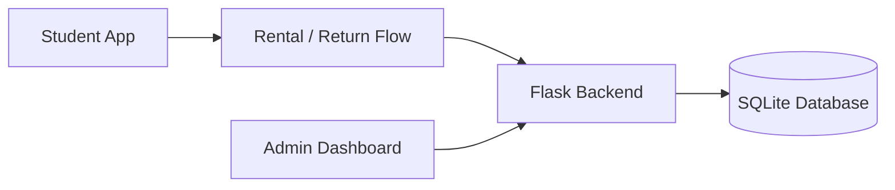

<!-- Profile README for https://github.com/rak-ship-it -->

# Rakesh | Engineer in the Making ⚙️

**Mechanical Engineering Student · Project Builder · Curious Problem Solver**

*Connecting engineering ideas with practical software.*

---

## 🧭 About Me

I'm a first-year **Mechanical Engineering student** interested in how engineering, design, and software can solve everyday problems.

I learn by building projects, testing ideas, fixing mistakes, and documenting what I discover. I'm currently exploring the overlap between physical systems and digital tools.

- ⚙️ **Interested in:** Mechanical systems, product design, mobility, and practical engineering
- 🛠️ **Building:** CampusBike, a campus bicycle-sharing software MVP
- 🌱 **Learning:** Software development, Git/GitHub, and engineering problem-solving
- 🎯 **Goal:** Build useful projects and develop strong hands-on skills

## 🚲 Featured Project

### [CampusBike — Smart Campus Mobility](https://github.com/rak-ship-it/CampusBike)

> **“Bike simple, station smart.”**

A software MVP exploring how campus bicycle rentals and fleet management could work in one system.

| Student mobile app | Admin dashboard |
| --- | --- |
| Rental and return flow, QR scanning, ride history, and maintenance reporting | Fleet and station management, dock assignment, student accounts, and ride exports |

**Built with**

**How the software flow fits together**

**Project status:** Software MVP for demonstration and further development. Physical smart locks and dock sensors are not implemented; docking confirmation is simulated.

➡️ **[Explore the repository, setup guide, and project documentation](https://github.com/rak-ship-it/CampusBike)**

## 🧰 My Learning Roadmap

- [ ] Build a small CAD or mechanical-design project and document the design decisions
- [ ] Learn more about prototyping, materials, and manufacturing
- [ ] Improve my programming and testing fundamentals
- [ ] Add clear photos, diagrams, test results, and lessons learned to future projects

## 📌 Engineering Mindset

I value **curiosity, honest documentation, iteration, and learning by doing**. This profile will grow as I build and share more projects.

*One idea. One prototype. One improvement at a time.* ⚙️

